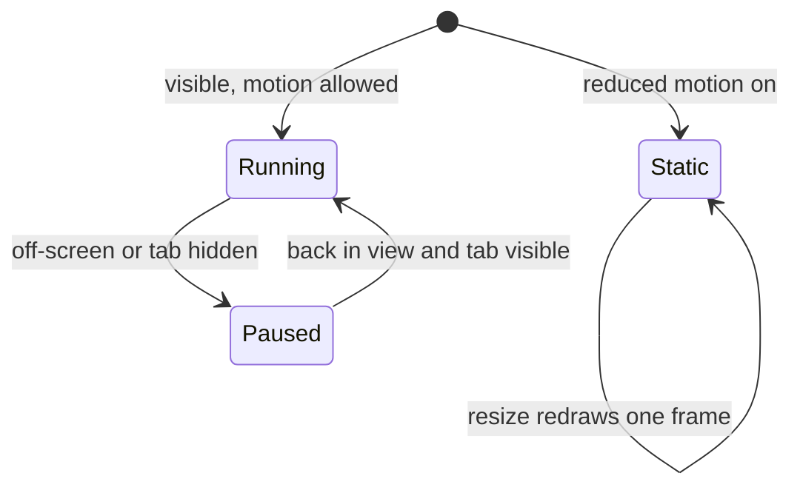

# Dust Canvas - Plan

## Goal Capsule

- **Objective:** Visitors opening the home page and the About page see dust hanging in the air like the reference: dense, softly drifting clouds set into a thin sprinkle. The dust reacts gently to their cursor or finger, and your name and the nav stay readable and clickable.
- **Means:** Improve the existing `js/dust.js` in place, driven by one composition recipe per variant (KTD1).
- **Product authority:** Backlog Feature 2 (`docs/backlog.md`), then this Product Contract, then the Planning Contract. This plan covers the dust effect and its two looks only. The intro screens it appears in (Feature 3 on home, the About intro) are not active scope.
- **Execution profile:** Plain JS, no build step and no new dependencies. One file carries almost all of the work, so execute units in order, inline.
- **Stop conditions:** Stop and ask the user if the clouds can't be kept clear of the name zone at 390px without breaking the reference layout (R5). Also stop if Lighthouse mobile Performance can't reach 90 at a speck count that still reads like the reference (R11).
- **Open blockers:** None.

---

## Product Contract

### Summary

The dust effect gets a dark and a cream look. Each has a fixed, composed layout of denser cloud patches that drift barely noticeably, set into a thin layer of slowly drifting specks. A cursor or finger pushes specks aside gently, and they ease back so the clouds keep their shape. The dark look stays on the home intro. The cream look is shown on the About test page, ready for the About intro screen.

### Problem Frame

The dust is the first thing a visitor sees on the home page, and later on the About page. Today it is an even, featureless sprinkle drifting one way. The reference gets its mood from denser clouds of dust in an otherwise sparse field (`reference/01-home-intro-dark.jpg`, `reference/04-about-intro-cream.jpg`). The current file has no clouds, and its cursor push only works over the bare canvas, not over the name or the nav. On phones it also rebuilds every speck whenever the window size changes, and that happens each time the browser's address bar shows or hides during a scroll.

### Key Decisions

- **Clouds hold a composed position and drift very slowly, barely noticeably.** (session-settled: user-directed — chosen over fully static patches, clouds sliding across the screen, and clouds that thin out and re-form elsewhere: stillness reads closest to the reference, and a hint of motion keeps it alive.) Governs R3, R4.
- **The cloud layout is composed, not random.** (session-settled: user-directed — chosen over random placement per visit and composed-with-jitter: every visit looks deliberate and the name is never covered.) Governs R2, R5.
- **Pushed specks ease back into place.** (session-settled: user-directed — chosen over leaving a lasting scattered trail: the clouds always keep their shape.) Governs R7.
- **A finger on touch screens pushes the dust too.** (session-settled: user-directed — chosen over no touch interaction.) Governs R8.
- **The cream look's real home is an About intro screen,** like reference 04: the name over cream dust, which then gives way to the split layout. (session-settled: user-directed — chosen over cream dust behind the About hero, or just having the variant ready.) This plan only demos it. Governs R12.

### Requirements

**Look**

- R1. There are two variants, dark and cream, chosen per page. Dark uses pale specks on the dark background. Cream uses warm brown specks on cream, many of them larger and softer, as if out of focus (reference 04).
- R2. Each variant has a fixed composed layout matching its reference. Dark has oval clouds bottom-left, middle-right and top-centre (the bottom band was dropped in a Feature 3 follow-up; the home intro fades the dust out softly instead). Cream has a dense band down the middle that thins toward the sides.
- R3. Between and around the clouds, a thin layer of specks of mixed size and brightness drifts slowly. Specks inside the clouds shimmer slightly.
- R4. The clouds drift so slowly that someone watching only just notices. Across a whole visit, the composed layout stays recognisable and never wanders away.
- R5. No cloud ever drifts over the name zone: the left side at upper-middle height, where the name sits in both references.

**Interaction**

- R6. Moving the cursor anywhere over the dust area pushes nearby specks gently away, including where the name or the nav sits on top.
- R7. Once the cursor moves on, pushed specks ease back to where they belong within a couple of seconds.
- R8. On touch screens, touching or dragging pushes specks the same way, and a normal swipe still scrolls the page.
- R9. The dust never intercepts input. Nav links, the name and anything else on top stay clickable and tappable, so the dust listens for pointer movement page-wide rather than on its own surface.

**Accessibility and performance**

- R10. With reduced motion on, the dust shows a single still frame with the clouds visible, and there is no cursor push.
- R11. The animation stops while the dust is off-screen or the tab is hidden, and resumes where it left off. Phones get fewer specks. Lighthouse mobile stays at 90 or above for Performance and Accessibility on both pages, with no console errors.
- R12. Resizing the window or rotating the phone keeps the composition steady, with no visible reshuffle, including when a phone's address bar shows or hides during a scroll.

**Placement in this feature**

- R13. The home intro keeps the dark dust behind the name.
- R14. The About test page (`about.html`) gets a full-screen cream dust section at the top as the demo. The real About intro screen, with the name and the hand-off into the split layout, is built in a later feature.

### Acceptance Examples

- AE1. **Covers R6, R9.** Given the home intro on desktop, when the cursor moves over the name, specks around it move aside. When the user clicks "About,", the About page opens.
- AE2. **Covers R7.** Given the cursor sweeps through a cloud and leaves the page, within about two seconds the cloud looks as it did before.
- AE3. **Covers R8.** Given a 390px phone, when the user drags a finger down across the intro, the page scrolls and the specks under the finger are pushed aside.
- AE4. **Covers R10.** Given reduced motion is on, when the page loads, a still frame with the clouds is shown, and moving the cursor changes nothing.
- AE5. **Covers R4, R5.** Given the page is left open for two minutes, the clouds sit roughly where they started and none has crossed the name.

### Success Criteria

- Side by side at 1440px, each variant reads like its reference screenshot: the same cloud placement, density contrast and speck character.
- The name stays readable over the dust. Contrast is measured from rendered pixels with the grain and vignette on, per `docs/solutions/ui-bugs/contrast-under-grain-vignette-overlays.md`.
- Both variants work at 1440px and 390px wide.

### Scope Boundaries

- The intro screen itself (the name glow, the fade into the page) is Feature 3.
- The real About intro screen and where it sits in the About split layout belong to the About features (4 and 5).
- Clouds that cross the screen, or that thin out and re-form, are out of scope.
- No new libraries. CLAUDE.md allows a canvas with plain JS only.

### Sources / Research

- `js/dust.js`: the current effect. Particles are spread evenly with one shared drift, the push listener is on the canvas, the particles are rebuilt on resize, and the loop doesn't stop off-screen.
- `index.html`: the home intro canvas (`data-dust="dark"`) sits under the h1 and the nav.
- `css/tokens.css` and `js/grain.js`: the global shell layering (content under the nav, under the grain and vignette).
- `docs/solutions/ui-bugs/contrast-under-grain-vignette-overlays.md`: how to measure contrast under the overlays.
- `docs/plans/2026-11-25-2223-feat-global-shell-plan.md`: the shell this effect sits inside.

**Product Contract preservation:** Restructured with no change to scope. Planning answered the three Deferred-to-Planning questions in KTD2 (how the drift moves), KTD3 (push and tuning) and KTD4 (touch), so the Outstanding Questions section was removed.

---

## Planning Contract

### Key Technical Decisions

- KTD1. **One composition recipe per variant, with every speck's home stored as a fraction of the canvas.** Each recipe lists its cloud ellipses (centre, radii, speck count), the thin-field density, the bottom band, the name-zone rectangle, and the speck style: colour, size range, alpha range and softness. Specks are generated once from the recipe. Their positions are stored relative to the canvas, so a resize or rotation only rescales them and nothing reshuffles (R12). The speck count and density tier (KTD6) are set once at load. A resize never adds or removes specks. Specks inside each cloud are random on every load, while the clouds themselves are fixed. Governs R2, R12.
- KTD2. **Cloud drift is a bounded sway around each cloud's home.** Each cloud centre follows a slow, closed path: two sine waves with different periods of roughly 45–90 seconds, and an amplitude of about 1.5–3% of the canvas. Its specks move with it. The recipe places clouds so that home plus the full sway amplitude never enters the name zone, which proves R5 by construction rather than with a check every frame. The thin field drifts slowly in one direction and wraps around the edges, as it does today. Specks inside clouds shimmer with a tiny per-speck wobble. Governs R3, R4, R5.
- KTD3. **The push moves a per-speck offset on a spring, never the speck's home.** Each speck carries an offset and a velocity. The cursor within a radius of about 90px (about 70px on phones) adds a force that falls off with distance. A damped spring pulls the offset back to zero, settling within about 2 seconds. The exact radius, force, damping and speck counts are tuned by eye against the references during U2 and U3. Governs R6, R7.
- KTD4. **Input is listened for on `window`, and the canvas gets `pointer-events: none`.** This was the user's direction: the push must never block nav clicks. Mouse and pen come from passive `pointermove`. Touch comes from passive `touchstart` and `touchmove` on `window`, never `preventDefault`. A touch-driven pointer stream gets cancelled once the browser starts scrolling, but touch events keep arriving during a scroll, so a swipe still scrolls and still pushes. Coordinates are mapped into each canvas's rectangle, and input outside it is ignored. The script sets `pointer-events: none` on every dust canvas itself, so no page can forget it. Governs R6, R8, R9.
- KTD5. **Specks are drawn as pre-rendered sprites.** At setup, each variant renders a small set of round speck sprites at a few sizes to offscreen canvases, with a radial soft edge for cream's out-of-focus specks. Each frame draws them with `drawImage` and a per-speck alpha. That costs about the same as today's flat rectangles and gives cream its soft look without canvas blur filters. Governs R1, R11.
- KTD6. **The loop runs only while the dust is visible.** An `IntersectionObserver` per canvas and `visibilitychange` on the document start and stop `requestAnimationFrame`. Time steps are clamped, so a resumed loop picks up where it left off without jumping. Device pixel ratio stays capped at 2. Phones (canvas narrower than 600px) get about 40% of the desktop speck density. Governs R11.
- KTD7. **Reduced motion is read once at load.** When it is on, the script builds the recipe, draws one frame with the clouds at their home positions, and attaches no input or animation listeners. A resize redraws that single frame. Governs R10.
- KTD8. **The variant attribute stays as it is: `data-dust="dark"` or `data-dust="light"`.** "light" is the cream look. CLAUDE.md and existing markup already use these values, so nothing else needs to change.

### High-Level Technical Design

Each speck's drawn position is built from separate layers, so drift, resize and push never interfere with each other:

```text
drawn = toPixels(home)        // fraction of the canvas, rescales on resize (KTD1)
      + cloudSway(cloud, t)   // bounded sway, cloud specks only (KTD2)
      + fieldDrift(t) wrapped // thin-field specks only (KTD2)
      + shimmer(speck, t)     // tiny wobble, cloud specks only
      + pushOffset            // spring toward zero, driven by input (KTD3)
```

The loop lifecycle:



### Assumptions

- The name zone covers where the name actually sits at each width, at about 18–48% of the canvas height. On desktop that is the left third. Below 600px it is about the left 70%, because at 390px the 32px name runs to roughly 260px. Feature 3 keeps the name there, or updates the recipe's name zone at the same time.
- Phone browsers that throttle `touchmove` during a scroll make the push less smooth, not broken. The user accepted this.

---

## Implementation Units

### U1. Composition recipes and steady layout

- **Goal:** Replace the even sprinkle with each variant's composed layout, slow cloud sway and thin drifting field, holding steady through resizes.
- **Requirements:** R1, R2, R3, R4, R5, R12. KTD1, KTD2, KTD5, KTD8.
- **Dependencies:** None.
- **Files:** `js/dust.js`.
- **Approach:**
  1. Define the `dark` and `light` recipes from the references. Dark has oval clouds bottom-left (about 30%, 80%), middle-right (about 75%, 62%) and top-centre (about 53%, 22%). The dense bottom band was later removed; the home intro fades the dust out over its bottom ~30% instead (Feature 3 follow-up). Light has a vertical band centred near 47% of the width that thins toward the sides. Below 600px, any cloud whose home plus sway would enter the wider phone name zone (see Assumptions) gets a phone-only home outside it. The top-centre dark cloud is the one this affects. If it can't still look like reference 01, the R5 stop condition applies.
  2. Generate specks from the recipe with home positions stored as fractions. Cloud specks use a Gaussian spread inside their ellipse, and field specks are uniform.
  3. Build the sprites per variant. Light uses warm brown (from `--ink` / reference 04) with larger, softer sizes. Dark uses pale near-white.
  4. Render loop: compose positions per the High-Level Technical Design and draw sprites. A resize only rescales (KTD1).
- **Patterns to follow:** The existing `js/dust.js` IIFE and its per-canvas setup. The `js/grain.js` comment style.
- **Test scenarios:**
  - Covers AE5. On `index.html` at 1440×900, the three dark clouds sit where reference 01 shows them, and none overlaps the name.
  - At 390×844, the same layout scales down and no cloud reaches the name.
  - Left open for two minutes, each cloud stays within its sway and returns near its start, and the field keeps drifting and wrapping.
  - Resizing the window and switching DevTools between 1440 and 390 changes layout scale with no visible reshuffle.
- **Verification:** A side-by-side screenshot against reference 01 reads as the same composition, and the console shows no errors.

### U2. Gentle push from cursor and finger

- **Goal:** Specks move aside around the cursor or finger anywhere over the dust and ease back, without ever blocking clicks or scrolling.
- **Requirements:** R6, R7, R8, R9. KTD3, KTD4.
- **Dependencies:** U1.
- **Files:** `js/dust.js`.
- **Approach:**
  1. Add a per-speck offset and velocity, and a spring step in the loop.
  2. Add passive `pointermove` (mouse and pen), `touchstart` and `touchmove` listeners on `window`. Map each position into the canvas rectangle, and clear the pointer when it leaves the window, on `touchend` and on `touchcancel`.
  3. Set `pointer-events: none` on each dust canvas from the script.
  4. Tune radius, force and damping by eye so the push stays gentle and pushed specks settle within about 2 seconds (KTD3).
- **Patterns to follow:** The existing push in `js/dust.js` for the distance test. The new spring replaces its permanent velocity change.
- **Test scenarios:**
  - Covers AE1. Moving the mouse over the home name pushes the specks around it, and clicking "About," opens `about.html`.
  - Clicking every nav link on both pages works with the dust running.
  - Covers AE2. After a sweep through a cloud, the cloud looks as it did before within about 2 seconds.
  - Covers AE3. With 390px touch emulation, a vertical drag scrolls the page and pushes specks under the finger.
  - The cursor over the nav at the top of the intro still pushes nearby specks.
  - Leaving the window with the cursor lets all specks settle back.
- **Verification:** All scenarios hold in Chrome desktop and in touch emulation, with no console errors.

### U3. Pausing, reduced motion and phone budget

- **Goal:** The dust costs nothing while out of view, respects reduced motion, and stays within the Lighthouse budget on phones.
- **Requirements:** R10, R11. KTD6, KTD7.
- **Dependencies:** U1, U2.
- **Files:** `js/dust.js`.
- **Approach:**
  1. Add an `IntersectionObserver` and `visibilitychange` start and stop, with clamped time steps.
  2. Add the reduced-motion branch: one frame at home positions, no listeners, and a redraw on resize.
  3. Scale speck density on narrow canvases, and cap DPR at 2.
- **Patterns to follow:** The reduced-motion handling in `js/grain.js` (static under `prefers-reduced-motion`).
- **Test scenarios:**
  - Covers AE4. With reduced motion emulated, a still frame with clouds is shown, and moving the cursor changes nothing.
  - After scrolling the intro out of view, the DevTools Performance panel shows no dust animation frames, and scrolling back resumes without a jump.
  - Switching to another tab and back resumes smoothly.
  - Lighthouse mobile scores Performance and Accessibility of 90 or above on `index.html` and `about.html`.
- **Verification:** All scenarios pass, and Lighthouse reports are recorded.

### U4. Cream demo on the About test page

- **Goal:** Show the cream look full-screen at the top of `about.html`, and leave the home intro's dark dust as it is.
- **Requirements:** R13, R14.
- **Dependencies:** U1.
- **Files:** `about.html`, `index.html` (check only, change nothing unless needed).
- **Approach:** Add a full-viewport section with a `data-dust="light"` canvas (`aria-hidden`) above the existing demo content in `about.html`, and load `js/dust.js` with `defer`. Mirror the `.intro` canvas CSS from `index.html` in the page's own style block. Update the stub's comment to say the About intro feature replaces this section.
- **Patterns to follow:** The `.intro` section and canvas CSS in `index.html`.
- **Test scenarios:**
  - `about.html` opens on a full-screen cream dust section, and scrolling reveals the existing demo content working: reveal and counters.
  - `index.html` still shows the dark dust behind the name, unchanged apart from the U1–U3 behaviour.
- **Verification:** Both pages load at 1440 and 390, with no console errors. A side-by-side screenshot of the cream section against reference 04 shows the central band with larger, softer brown specks.

---

## Verification Contract

This repo has no test runner or build step (CLAUDE.md), so verification is browser-driven, like Feature 1.

| Check | How | Pass |
|---|---|---|
| Local serve | `python -m http.server 5500`, then open `http://localhost:5500` | Both pages load |
| Desktop and phone | Chrome DevTools at 1440×900 and 390×844, with touch emulation for 390 | U1–U4 scenarios hold |
| Reference match | Screenshots beside `reference/01-home-intro-dark.jpg` and `reference/04-about-intro-cream.jpg` | Same cloud placement, density contrast and speck character |
| Reduced motion | DevTools → Rendering → emulate `prefers-reduced-motion: reduce` | Still frame with clouds, no push |
| Clicks and scroll | Click every nav link with dust running, and drag-scroll at 390 | All work |
| Name contrast | Pixel sampling with grain and vignette on, per `docs/solutions/ui-bugs/contrast-under-grain-vignette-overlays.md` | Home name ≥ 4.5:1 against the dust behind it |
| Console | DevTools console on both pages | No errors |
| Lighthouse | DevTools Lighthouse mobile on both pages | Performance ≥ 90, Accessibility ≥ 90 |

---

## Definition of Done

- U1–U4 are complete, and every Verification Contract row passes on `index.html` and `about.html`.
- R1–R14 hold, and AE1–AE5 are demonstrated.
- `js/dust.js` keeps its usage comment at the top, updated for the new behaviour.
- No leftover test pages, commented-out experiments, or tuning code from abandoned attempts.
